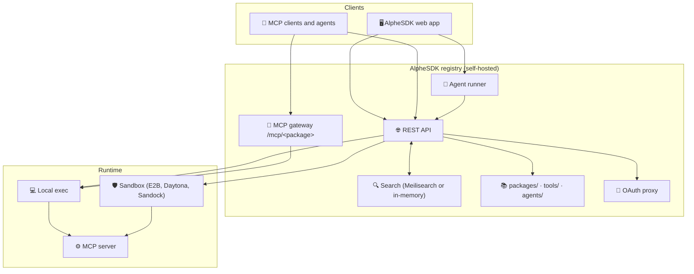

<div align="center">


# OrdisSDK

**AlpheSDK: the toolbox for your AI agents.**

A self-hosted catalog, gateway and workbench for [Model Context Protocol](https://modelcontextprotocol.io)
(MCP) servers, tools and agents. Find a server, test its tools, copy a ready-made client config, or
chat with an agent that uses them, from one web app and one HTTP API.


[Quick start](#quick-start) · [Deploy on Vercel](#deploy-on-vercel) · [Configuration](#configuration) · [API](#api) · [Add to the catalog](#add-to-the-catalog)

</div>

---

This repository holds **AlpheSDK**, which has:

- **A catalog** of 4,232 MCP servers in 30 categories (1,359 validated, 230 reachable as remote
  servers), 14,000+ indexed tools and 6 ready-made agents.
- **A web app**: a desktop-style workspace to search the catalog, inspect servers, run tools from a
  generated form, copy client configs and chat with agents.
- **A REST API** with an OpenAPI reference at `/swagger`.
- **An MCP gateway** that exposes every registered server as a Streamable HTTP endpoint at
  `/mcp/<packageName>`, including servers that only speak STDIO.
- **An agent runner** that chats through [OpenRouter](https://openrouter.ai) and calls MCP tools,
  streamed as server-sent events.
- **Search** with Meilisearch, or in memory when Meilisearch isn't configured.
- **Sandboxes**: Node.js servers can run in Sandock, E2B or Daytona instead of on the host.
- **An OAuth proxy** for remote servers that need OAuth.

<a id="quick-start"></a>

## Quick start

### Requirements

- Node.js 22.12 or newer (20.19+ also works; developed on Node 24)
- pnpm 9 or 10. pnpm 10 skips the install scripts of dependencies, which some MCP server packages
  need (for example to download a browser). If such a server fails to start, run `pnpm approve-builds`.
- Optional, to run MCP servers of other runtimes on your machine: [uv](https://docs.astral.sh/uv/)
  for Python servers, Go for Go servers, Docker for Docker servers. Java servers are listed but
  can't run.

### Run it

```bash
git clone https://github.com/codetoinfinite/OrdisSDK.git
cd OrdisSDK
pnpm install                # API dependencies
pnpm --dir web install      # web app dependencies (separate package)
pnpm web:build              # builds the web app into web/dist
pnpm start                  # http://localhost:3003
```

Open http://localhost:3003 for the web app and http://localhost:3003/swagger for the API reference.
No configuration is needed to browse, search and run servers locally. To change defaults, copy
`.env.example` to `.env` and uncomment what you need (see [Configuration](#configuration)).

### Develop

```bash
pnpm dev        # API with reload on http://127.0.0.1:3003
pnpm web:dev    # second terminal: web app with hot reload on http://127.0.0.1:5173
```

> [!IMPORTANT]
> `pnpm dev` stops at startup unless `POSTHOG_PROJECT_TOKEN` and `POSTHOG_HOST` are set (in
> `.env.local` or `.env`). Without PostHog, use `pnpm start`, which runs in production mode.

### Docker

```bash
docker compose up -d --build
```

This starts the app on http://localhost:3003 and Meilisearch on port 7700, both bound to
`127.0.0.1`. Search uses Meilisearch in this setup. Compose passes `SANDOCK_API_KEY` and
`OPENROUTER_API_KEY` from your shell or from a `.env` file next to `docker-compose.yml`. MCP servers
run inside the container by default. The image has Node.js and Python with uv, but no Go.

<a id="the-flow"></a>

## The flow

The web app is a desktop-style workspace: a menu bar, desktop icons and windows you can open side by
side. Every window has its own URL, so deep links and the browser back button work.

1. **Discover**: search servers, tools and agents together; filter by category, verified status,
   runtime and whether keys are needed.
2. **Inspect**: open a server to see its description, environment variables and tools.
3. **Configure**: enter the keys a server needs. They stay in your browser session.
4. **Test**: list the server's tools live and run one with a generated form.
5. **Connect**: copy a config for Claude Code, Claude Desktop, Cursor, VS Code, curl or the MCP SDK.
6. **Run**: chat with an agent that calls the tools of the servers you picked.

**Get started** in the menu bar walks through these steps as a checklist.

<a id="deploy-on-vercel"></a>

## Deploy on Vercel

The repository is ready for Vercel. `vercel.json` sets the framework (none), the install command and
the build command, so there is nothing to configure for a first deploy.

1. In Vercel, choose **Add New → Project** and import this repository.
2. Keep the defaults: root directory `./`, no output directory. The build writes
   `.vercel/output` ([Build Output API](https://vercel.com/docs/build-output-api)), which Vercel
   deploys as is.
3. Use Node.js **24.x** (the default) or **22.x**: **Settings → Build and Deployment → Node.js
   Version**. The API function runs on the Node.js version the build used.
4. Add the environment variables you need (below) and deploy.

What the build does:

1. `pnpm --dir web install --frozen-lockfile` installs only the web app's dependencies. The root
   dependencies, mostly MCP server packages, aren't needed on Vercel.
2. `pnpm --dir web build` builds the web app.
3. `node scripts/vercel-build.mjs` bundles the API (`src/api/vercel.ts`) into one Node.js function
   with esbuild, installs its npm dependencies at the versions pinned in `pnpm-lock.yaml`, copies
   the catalog data it reads at runtime, and adds the web app as static files. Requests to `/api`,
   `/mcp`, `/swagger` and `/demo` go to the function; every other path serves the web app.

### Protect the deployment

> [!WARNING]
> The API has no authentication. Anyone who can reach the deployment can run tools, use the MCP
> gateway and spend your OpenRouter credits. Turn on **Settings → Deployment Protection → Vercel
> Authentication** and set it to **All Deployments**. The default, Standard Protection, leaves
> production domains public.

Scripts and MCP clients can still reach a protected deployment: create a secret under **Protection
Bypass for Automation** and send it in the `x-vercel-protection-bypass` header.

### What runs on Vercel

Vercel functions can't start local processes, so the deployment runs:

| Works | Doesn't work |
|---|---|
| Web app, catalog, search (in memory), Swagger | Local Python, Go and Docker servers |
| Remote servers: list tools, run tools, MCP gateway | Node.js servers when no sandbox provider is set |
| Node.js servers through a sandbox provider: list and run tools | Node.js servers through the MCP gateway (it doesn't use sandboxes) |
| Agent chat (with `OPENROUTER_API_KEY`) using the servers above | Java servers (not supported anywhere) |

A request for a server that can't run returns: *Vercel can't start local MCP servers (&lt;package&gt;).
Node packages can run in a sandbox: set MCP_SANDBOX_PROVIDER to SANDOCK, E2B or DAYTONA.*

Notes:

- To run Node.js servers, set `MCP_SANDBOX_PROVIDER` to `SANDOCK`, `E2B` or `DAYTONA` and add that
  provider's key.
- Set `OPENROUTER_API_KEY` for agent chat.
- Set `REGISTRY_BASE_URL` to your deployment URL (for example `https://<your-domain>`) so OAuth
  callbacks point at it.
- Leave `ENABLE_SEARCH` unset: search runs in memory. Meilisearch would need a separately hosted
  instance.
- Don't set `DEBUG` unless both PostHog variables are set; with `DEBUG` the function stops at
  startup without them.
- MCP gateway and OAuth sessions live in the memory of one function instance. A request that lands
  on another instance gets "Session not found or expired"; start a new session.

<a id="configuration"></a>

## Configuration

Everything is optional. Settings come from environment variables; locally, `.env.local` and `.env`
are read too, and `.env.local` wins. `.env.example` lists every variable. Never commit real values.

| Variable | Default | Purpose |
|---|---|---|
| `PORT` (or `MCP_SERVER_PORT`) | `3003` | Port of the API and web app |
| `HOST` | `127.0.0.1` | Address to bind. Use `0.0.0.0` only behind authentication. |
| `REGISTRY_BASE_URL` | `http://localhost:<port>` | Public URL of the app, used for OAuth callbacks |
| `MCP_SANDBOX_PROVIDER` | `LOCAL` | Where Node.js servers run: `LOCAL`, `SANDOCK`, `E2B` or `DAYTONA` |
| `SANDOCK_API_KEY`, `SANDOCK_API_URL` | none, `https://sandock.ai` | Sandock sandbox |
| `E2B_API_KEY` | none | E2B sandbox |
| `DAYTONA_API_KEY`, `DAYTONA_API_URL` | none | Daytona sandbox |
| `ENABLE_SEARCH` | `false` | `true` uses Meilisearch; otherwise search runs in memory |
| `MEILI_HTTP_ADDR`, `MEILI_MASTER_KEY` | `http://localhost:7700`, none | Meilisearch connection |
| `OPENROUTER_API_KEY` | none | Enables agent chat |
| `OPENROUTER_MODEL` | `anthropic/claude-sonnet-5` | Model used when neither the agent nor the request names one |
| `MCP_OAUTH_CLIENT_ID`, `MCP_OAUTH_CLIENT_SECRET` | `mcp-registry`, none | OAuth client for servers whose authorization server has no dynamic client registration |
| `POSTHOG_PROJECT_TOKEN`, `POSTHOG_HOST` | none | Sends logs to PostHog. Required by `pnpm dev` and whenever `DEBUG` is set. |
| `DEBUG` | none | Makes the PostHog variables required in production too |

<a id="api"></a>

## API

The web app uses the same HTTP API. The full reference, with request and response schemas, is at
`/swagger` (OpenAPI JSON at `/api/v1/doc`).

| Method | Path | Purpose |
|---|---|---|
| GET | `/api/v1/search?q=` | Search servers, tools and agents |
| GET | `/api/v1/search/suggest`, `/search/facets`, `/search/health` | Suggestions, filter counts, search status |
| POST | `/api/v1/search/manage/init`, `/manage/index`, `/manage/clear` | Manage the search index (GET `/search/manage/stats`) |
| GET | `/api/v1/catalog/stats`, `/categories`, `/featured` | Catalog overview |
| GET | `/api/v1/catalog/server?packageName=` | One server |
| GET | `/api/v1/catalog/agents`, `/agent?key=` | Agents |
| GET | `/api/v1/catalog/tools`, `/tool?key=` | Curated tools |
| GET | `/api/v1/packages/detail?packageName=` | Server config and tools |
| GET | `/api/v1/packages/tools?packageName=` | List a server's tools live |
| POST | `/api/v1/packages/run` | Run a tool |
| GET | `/api/v1/indexes/packages-list` | The server index |
| GET | `/api/v1/config/featured`, `/categories` | Featured servers and categories |
| POST | `/api/v1/oauth/prepare`, `/refresh` | OAuth for remote servers (callback: GET `/api/v1/oauth/callback`) |
| POST | `/api/v1/agents/chat` | Chat with an agent (server-sent events) |
| any | `/mcp/<packageName>` | MCP gateway (Streamable HTTP) |
| GET | `/api/meta` | Version |

**Run a tool**

```bash
curl -X POST http://localhost:3003/api/v1/packages/run \
  -H "Content-Type: application/json" \
  -d '{
    "packageName": "@modelcontextprotocol/server-everything",
    "toolKey": "echo",
    "inputData": { "message": "Hello from AlpheSDK!" },
    "envs": {}
  }'
```

**Search the catalog** (servers, tools and agents in one index)

```bash
curl "http://localhost:3003/api/v1/search?q=github&type=mcp&validated=true"
```

**MCP gateway**: every registered server is reachable as a standard
[Streamable HTTP](https://modelcontextprotocol.io/specification/2025-03-26/basic/transports#streamable-http)
endpoint at `/mcp/<packageName>`. Pass the server's environment variables as `x-mcp-env-<NAME>`
headers. Any MCP client that supports Streamable HTTP can connect; with curl it looks like this:

```bash
# 1. Start a session. The response carries an mcp-session-id header.
curl -i -X POST http://localhost:3003/mcp/@modelcontextprotocol/server-github \
  -H "Content-Type: application/json" \
  -H "Accept: application/json, text/event-stream" \
  -H "x-mcp-env-GITHUB_PERSONAL_ACCESS_TOKEN: <your-github-token>" \
  -d '{"jsonrpc":"2.0","id":1,"method":"initialize","params":{"protocolVersion":"2025-03-26","capabilities":{},"clientInfo":{"name":"curl","version":"1.0.0"}}}'

# 2. Call methods in that session.
curl -X POST http://localhost:3003/mcp/@modelcontextprotocol/server-github \
  -H "Content-Type: application/json" \
  -H "Accept: application/json, text/event-stream" \
  -H "mcp-session-id: <id from step 1>" \
  -d '{"jsonrpc":"2.0","id":2,"method":"tools/list"}'
```

Sessions expire 30 minutes after they start.

**Agent chat** streams server-sent events (`tool_call`, `tool_result`, `message`, `done` and more):

```bash
curl -N -X POST http://localhost:3003/api/v1/agents/chat \
  -H "Content-Type: application/json" \
  -d '{ "agentKey": "everything-tester", "messages": [{ "role": "user", "content": "Add 2 and 3" }] }'
```

<a id="add-to-the-catalog"></a>

## Add servers, tools and agents

| Item | Folder | Guide |
|---|---|---|
| MCP server | `packages/<category>/<name>.json` | [Contributing](./docs/CONTRIBUTING.md) |
| Tool (a named entry point to one MCP tool) | `tools/<category>/<key>.json` | [Catalog guide](./docs/CATALOG.md) |
| Agent (a prompt plus the servers it may use) | `agents/<category>/<key>.json` | [Catalog guide](./docs/CATALOG.md) |

Run `pnpm validate:catalog` (tools and agents) or `pnpm validate:registry` (servers), then restart the
API or call `POST /api/v1/search/manage/index` to reload. The full server list is in
[docs/ALL-MCP-SERVERS.md](./docs/ALL-MCP-SERVERS.md). For a private deployment you can prune
`packages/` to the servers you need; see the
[package management guide](./docs/DEVELOPMENT.md#5--package-management-for-private-deployment).

## Scripts

| Command | What it does |
|---|---|
| `pnpm start` | API and web app in production mode |
| `pnpm dev` | API with reload (needs the PostHog variables) |
| `pnpm web:dev` | Web app dev server with hot reload; proxies API calls to port 3003 |
| `pnpm web:build` | Builds the web app into `web/dist` |
| `pnpm test` | Unit tests (Vitest) |
| `pnpm build` | Compiles the API with `tsc` |
| `pnpm check` | Lints and formats with Biome, writing fixes |
| `pnpm validate:catalog` | Validates `tools/` and `agents/` |
| `pnpm validate:registry` | Validates every server in `packages/` |

## Project layout

```
src/api/          server entry points: index.ts (Node.js), vercel.ts (Vercel), app.ts, web-app.ts
src/domains/      agent, catalog, config, executor, mcp-gateway, oauth, package, registry, sandbox, search
src/shared/       environment config, MCP client, blocklist and other helpers
web/              React web app (Vite), with its own package.json and lockfile
packages/         one JSON file per MCP server, by category
indexes/          generated indexes: validation results and cached tool lists
tools/, agents/   curated tools and agents
config/           categories, featured, verified and blocked servers
scripts/          catalog pipeline, validators and the Vercel build
python-mcp/       pyproject.toml for Python servers
e2b-template/     E2B sandbox templates
docs/             guides and the full server list
```

## Architecture



## Validated servers

A server marked `validated: true` in `indexes/packages-list.json` has been installed and started, and
its tool list was read successfully. Its tools are cached in the index, so the web app can show them
without starting the server. Validated doesn't mean every tool works or is safe to run. Packages
listed in `config/hosting-blacklist.mjs`, such as entries whose registry name points at a different
project's package, are never run.

## Security

- MCP servers are third-party code. With `MCP_SANDBOX_PROVIDER=LOCAL` (the default) they run on the
  host with the API's permissions. Sandboxes isolate Node.js servers only; other runtimes run on the
  host, and if a sandbox run fails, the tool runs on the host instead.
- The API has no authentication or rate limits. It binds to `127.0.0.1` by default; set
  `HOST=0.0.0.0` only behind authentication, and protect Vercel deployments (see above).
- Server keys entered in the web app stay in the browser session (or local storage when you choose
  "Remember") and reach the API only in request bodies and `x-mcp-env-*` headers.
- `.env` and `.env.local` are git-ignored. `.dockerignore` doesn't exclude `.env`, so a local `.env`
  is copied into images you build; don't publish such an image.

## Limitations

- Servers in other runtimes need their tools installed: uv for Python, Go for Go, Docker for Docker.
  Java servers can't run.
- 668 servers need API keys or other configuration before they start.
- MCP gateway and OAuth sessions are kept in memory, so they end when the process restarts.
- On Vercel, only remote servers and sandboxed Node.js servers run (see
  [What runs on Vercel](#what-runs-on-vercel)).

## License

MIT, see [LICENSE](./LICENSE). Each MCP server in the catalog belongs to its authors and has its own
license.
